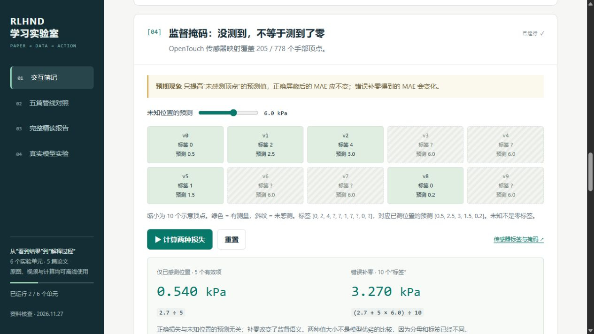

# RLHND 学习实验室

以 RLHND 为主线的中文论文学习与分享项目：六个可运行的教学单元、五篇论文的数据管线精读，以及 HumanWAM-Goal 官方推理服务接入。

[完整精读报告](report.md) · [35 分钟分享讲稿](分享讲稿.md) · [验收记录](notes/验收记录.md) · [来源与署名](ATTRIBUTION.md)

在 GitHub 上可通过 **Code → Download ZIP** 下载并解压项目，再打开 index.html。GitHub 的文件查看页不会直接执行 HTML。

直接打开 **index.html**。这是一个独立 HTML，原图、6 段作者视频、脚本和样式均已内嵌；教学部分不需要网络、账户、Python 或模型权重。推荐用桌面版 Chrome / Edge。网络只用于点击论文来源、访问外部链接或显式请求你配置的模型服务。

## 交付内容

| 文件 | 用途 |
|---|---|
| index.html | 交互教学笔记、五篇对照、完整报告、真实服务接入 |
| report.md + assets/ | 可编辑的中文精读报告和论文原图，图片使用相对路径 |
| 分享讲稿.md | 约 35 分钟的讲解路线、现场操作与提问 |
| serve_demo.py | 可选：本地网页服务与官方 GoalWAM HTTP 桥接；不包含模型 |
| app/ | HTML、CSS、JS 和构建脚本 |
| tests/ | 机制边界与 HTTP 协议检查，另有明确标记的浏览器测试服务 |
| notes/验收记录.md | 已检查的内容、来源版本和未完成的真实模型计算 |

作者结果回放、构造数据计算和模型服务响应是三种不同的证据。页面会在所在位置说明类型。六个教学单元都有预期现象、运行按钮和可检查结果；调整参数会清空旧结果，避免把旧输出当作新输出。

全文覆盖 RLHND v1、Movens-Zero v1、Ego2Robot v1、Qwen-RobotManip v2、Open-HumanWAM v3。详见报告首表。RLHND 是 arXiv **2610.09455**，另一篇 2610.41877 是 Movens-Zero。

## 本地预览

在本目录打开 PowerShell：

~~~powershell
uv run python serve_demo.py
~~~

若已安装 Python 3.10+：

~~~powershell
python serve_demo.py
~~~

访问 http://127.0.0.1:18765 。服务仅监听本机。没有配置 upstream 时，教学正常可用；真实模型页明确报告“未配置模型服务”，推理按钮保持禁用。退出运行服务的终端或按 Ctrl+C 可停止。

如果 18765 被占用，可加 --port 18767，并访问相应端口。不需要修改 HTML，API 跟随同一来源地址。

## 连接真实 HumanWAM-Goal

**已经实现接入，尚未在本次工作中完成模型权重推理。** 本机 Windows / RTX 5060 Laptop 8GB 不符合官方发布的 Goal 推理环境。RLHND 官方项目仓库目前没有推理实现与 checkpoint，因此本材料没有伪造 RLHND 接口。

本页连接的是新增论文中的 **HumanWAM-Goal 策略**，它根据图像、目标、状态和文字预测动作；不会从人手视频生成 RLHND 标签。

### 1. 在满足条件的机器准备官方服务

官方当前方案要求 Linux、GLIBC ≥ 2.34、Python 3.13、CUDA 12.8 和 Hopper SM90 GPU；native 后端使用 PyTorch 2.10。按 [官方 README](https://github.com/DAGroup-PKU/HumanNet/tree/Open-HumanWAM/humanwam_goal) 选择计算资源，不把本地教学运行成功等同于模型能在当前显卡运行。

下面命令在符合条件的 Linux 主机执行。本次没有替你运行这些权重下载与安装：

~~~bash
git clone --branch Open-HumanWAM https://github.com/DAGroup-PKU/HumanNet.git
cd HumanNet
git checkout e43925f7600aab4aa9200b2e39f5674fc0d97b89
cd humanwam_goal
bash scripts/setup_environment.sh /path/to/native-env
source /path/to/native-env/bin/activate

hf download DAGroup-PKU/HumanWAM-Goal-RoboTwin --exclude "*goal_cache.tar" \
  --local-dir checkpoints/HumanWAM-Goal-RoboTwin

goalwam serve --checkpoint checkpoints/HumanWAM-Goal-RoboTwin
~~~

默认官方服务为 127.0.0.1:8000。若在远程主机运行，在本机建立 SSH 转发（替换实际用户名和主机）：

~~~powershell
ssh -N -L 8000:127.0.0.1:8000 user@your-gpu-host
~~~

保持该终端运行，然后在本材料目录的另一个终端启动：

~~~powershell
uv run python serve_demo.py --upstream http://127.0.0.1:8000
~~~

打开 http://127.0.0.1:18765 → “真实模型实验” → “检查服务连接”。已有其他端口转发时相应修改 upstream。桥接器的上游地址只能在启动时指定；页面不会扫描或发现远程模型。

### 2. 选择图像，准备匹配的状态

页面会把当前 head 视角图像和目标 head 图像编码为**纯 base64**，连同指令、JSON 状态与时间信息发到官方 /infer。图像只在你点击“请求真实推理”时发送到配置的服务。页面不保存上传图像。

支持两种互斥状态模式：

- **归一化模式**：normalized_state、state_valid_mask、action_valid_mask 各 49 维，另有 domain_id。42:49 必须屏蔽；所有关节通道关闭时 domain_id = −1。默认全零输入只是构造的接口样例，不能代表上传图像中的实际状态，也不能据其输出判断任务能力。
- **物理状态模式**：state 49 维。点击模板按钮后，所有 null 都要换成实际测量。位置、四元数和夹爪约定以 checkpoint 的 robot.json 与官方协议为准。公开接口用 **xyzw**；论文基础动作描述中的 wxyz 不能直接照搬。

history 初始可为 []，历史图像需要采用同样的 base64 格式，时间戳必须早于当前。可在 JSON 中填写已有的左/右腕视角及其他官方字段；上传控件会覆盖 images.head 和 goal_images.head。

输入详细定义见 [固定提交的 docs/inputs.md](https://github.com/DAGroup-PKU/HumanNet/blob/e43925f7600aab4aa9200b2e39f5674fc0d97b89/humanwam_goal/docs/inputs.md)。如果只想先验证官方安装，可在模型主机运行仓库自带的 examples/make_sample.py；它同样是合成输入，结果不代表真实任务表现。

### 3. 检查输出

归一化模式应返回 normalized_actions: [1,48,49] 及 prefix_length。物理模式还返回 actions、relative_actions 和 action_valid_mask。

页面绘制归一化通道 26 / 34，展示第一步与返回字段，并支持下载完整实际响应。这些曲线的数值不是直接以米为单位的末端位置。页面没有机器人控制通道；真实任务评估另需官方 RoboTwin 评估环境或机器人控制器。

## 修改与验证

构建单文件 HTML 需要 Python-Markdown；使用 uv 可一次性准备：

~~~powershell
uv run --with markdown python app/build.py
node --test tests/math.test.cjs
uv run python tests/test_proxy.py
~~~

数学测试覆盖缓存首个合格窗口/严格阈值/无合格回退、接触边界、掩码不变性、分配守恒和动作块维度。代理测试使用本机协议 fixture，**不会加载模型或访问 GPU**。tests/browser_fixture.py 只用于开发验收，返回带 test_fixture: true 的构造数组，不能用于展示真实模型效果。

原图、项目视频与研究结果归各论文作者所有，具体来源见 [ATTRIBUTION.md](ATTRIBUTION.md)。中文解释和交互教学代码为本次整理。原始 PDF、Doc2X 解析、研究过程文件与生成的 ZIP 不进入 Git 版本库；原始资料链接在报告中，完整本地研究材料保留在制作时的工作目录 sources/ 中。
