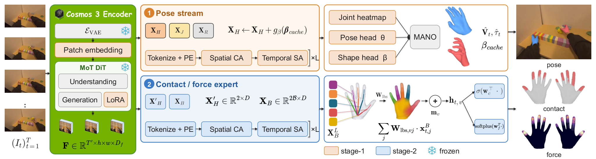
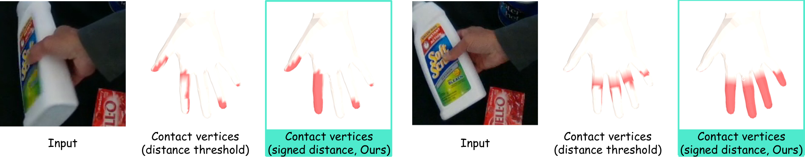
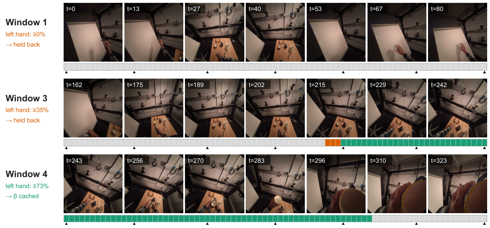
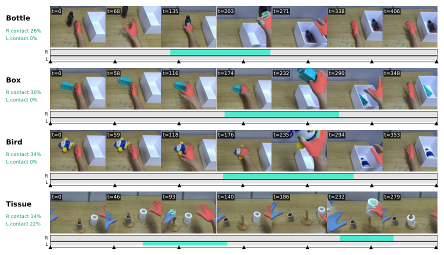
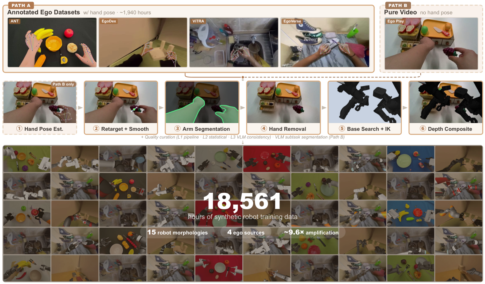
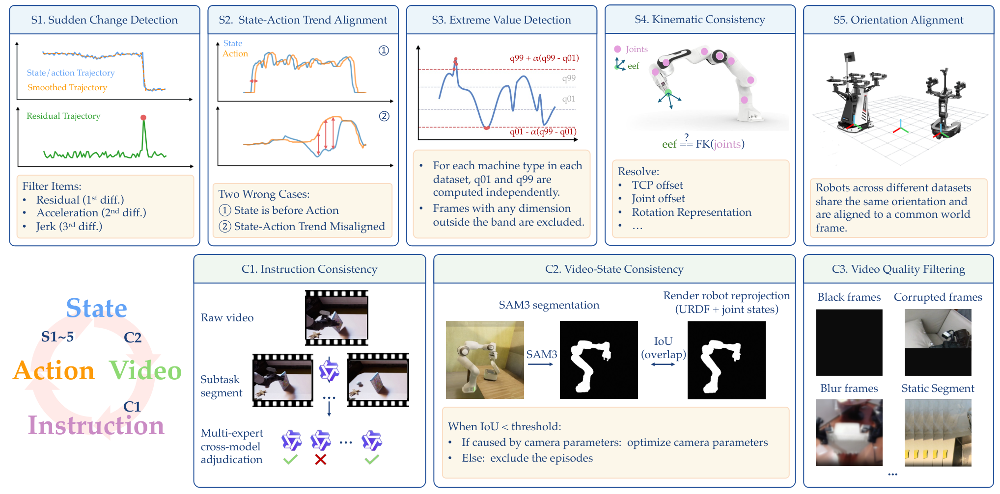
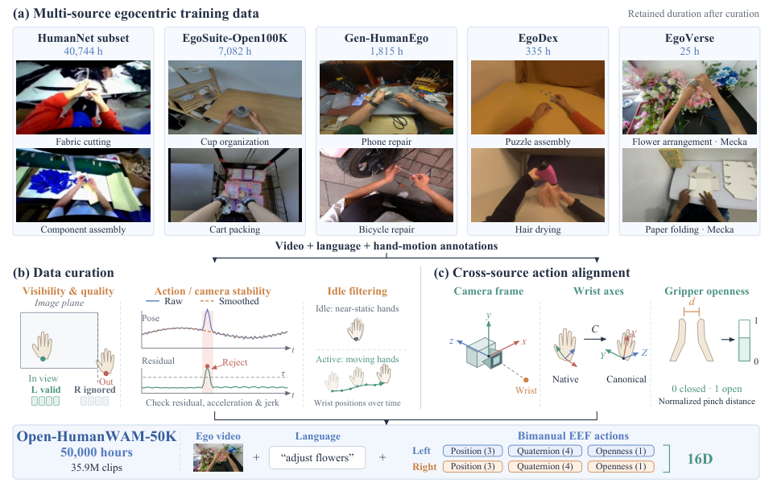
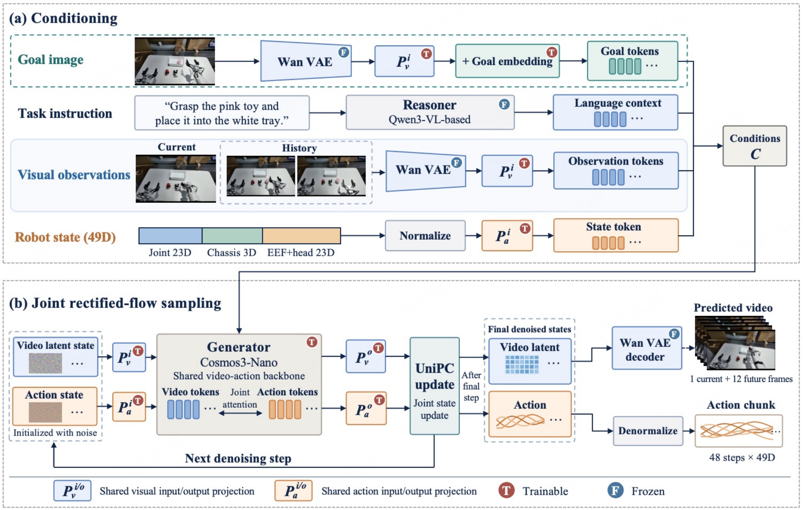
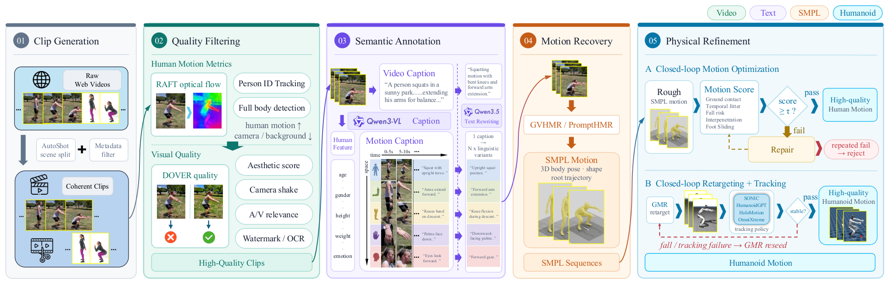
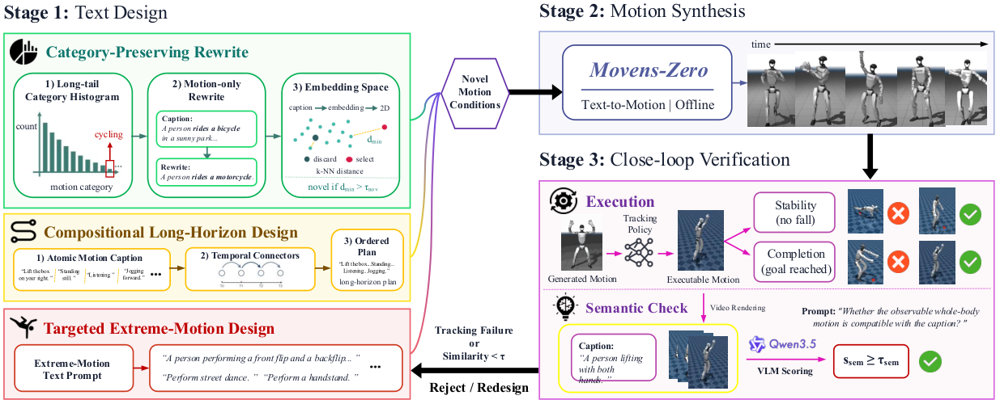

# 从人体视频到机器人训练样本：以 RLHND 为主线的五篇论文精读

这份报告服务于两个目标：自己能沿着一条数据讲清楚处理过程；分享时能用 HTML 中的按钮、图像和中间结果，让听众检查同一条推理链。重点是 **RLHND 如何把人手视频变成可用的动作与触觉标签**，再解释其余四篇如何处理数据合成、跨来源对齐、策略训练和全身动作验证。

报告中的“论文描述”来自指定版本正文、附录和原图；“机制解释”是对其含义的说明；交互页面里的小数组和几何场景均为教学构造。作者视频是已有推理结果的回放。文中的机器人动作样本格式用于解释字段，除明确标注的官方 HTTP 协议外，不代表作者代码的序列化接口。

## 1. 先放对位置：五篇论文解决的不是同一个问题

| 论文与本次固定版本 | 原始输入 | 管线的主要产物 | 在本次分享中的作用 |
|---|---|---|---|
| [RLHND · 2610.09455v1](https://arxiv.org/abs/2610.09455v1) | 单目第一人称视频；训练时使用多种有标签手部数据 | 双手姿态、手形、相机坐标中的位置、逐顶点接触与压力预测 | 主线：怎样得到更可靠的人手标签 |
| [Ego2Robot · 2608.02580v1](https://arxiv.org/abs/2608.02580v1) | 已标注手部轨迹的数据集，或无标注第一人称视频 | 带渲染机器人外观、EEF 动作和指令的合成训练数据 | 对照：从人手标签到机器人格式的数据 |
| [Qwen-RobotManip · 2606.17846v2](https://arxiv.org/abs/2606.17846v2) | 机器人数据、人体数据、人转机器人合成数据，另有 VL 数据流 | 对齐到统一动作空间的 VLA 训练样本及策略 | 对照：混合来源如何清洗、对齐、屏蔽无效监督 |
| [Open-HumanWAM · 2611.06817v3](https://arxiv.org/abs/2611.06817v3) | 五个人体数据来源；混合训练阶段再加入机器人经验 | 50,000 小时人体语料；HumanWAM-Vanilla 与 HumanWAM-Goal | 对照：人体数据规模、动作对齐与视觉目标怎样共同影响策略 |
| [Movens-Zero · 2610.41877v1](https://arxiv.org/abs/2610.41877v1) | 互联网全身动作视频与多模态条件 | SMPL-X 人体动作、机器人参考轨迹、验证后的 rollout；动作生成模型 | 对照：运动学合理之后，为什么还要执行验证 |

**这张表是概念上的关系图，不是作者已经联合实现的系统。** Ego2Robot 的无标注视频路径实际使用 WiLoR 和 DynHaMR；本文没有证据说它使用了 RLHND。Movens-Zero 处理全身动作，也不以 RLHND 的人手网格为输入。把 RLHND 换入某条管线，需要另外处理坐标、时间采样、手部定义和标签接口。

文中 EEF 指末端执行器（例如夹爪），TCP 指在末端上选定的工具中心参考点。描述“末端怎样动”时，既要说明位置/朝向，也要说明参考点选在哪里；换了 TCP，同一关节姿态对应的位置数值就会不同。

五篇共有的难点是：视频中的动作看起来合理，并不意味着训练监督正确。错误可以发生在三维重建、传感器标签、时间同步、坐标系、机器人运动学，以及最终执行中的任何一层。

## 2. RLHND：先理解它究竟输出什么

**一句话流程：** 视频按片段输入预训练视频模型，提取时空特征；姿态分支输出受解剖约束的手部姿态、可缓存手形与相机坐标位置；独立触觉分支输出手表面的接触概率与压力分布；这些结果经过下游打包，才能成为机器人策略的监督。

*RLHND v1，Figure 2，PDF 第 4 页。看三处关系：左侧视频特征；上方姿态与手形；下方触觉专家及 LBS 特征扩散。训练第二阶段冻结整个第一阶段模型，依据附录 A.5。图是结构示意，压力头的计算细节以 §3.3 正文为准。*

### 2.1 MANO、姿态、手形和位移分别是什么

MANO 是一个参数化手部模型。可以把它理解为固定拓扑的手网格：给定人的手形、关节转动和全局摆放，就能生成三维顶点和关节。RLHND 每只手使用 778 个网格顶点；手形参数 β 是 10 维，用来描述一只手的几何形态。它不是每一帧的动作。姿态参数随帧改变；相机坐标平移 τ 则说明这只手位于相机前方什么位置。

RLHND 同时预测每帧的手部存在/可见性。关节存在不代表当前监督一定可用，训练还需要按来源和标签类型设置有效掩码。触觉输出有两种：每个顶点的接触概率 c，以及非负的逐顶点压力值 f。论文沿用“force”一词，但训练标签和 MAE/RMSE 的单位是 **kPa**，不是牛顿；没有顶点面积等额外信息，不能把这些数直接解释为机器人应该施加的真实接触力。[RLHND §3、§3.3、附录 A.2/A.4](https://arxiv.org/html/2610.09455v1#S3)

### 2.2 学会预测之前：三类标签沿不同路径进入训练

这部分最容易被架构图遮住。RLHND 并非拿所有视频走一套清洗器，更不是直接从无标签视频里得到了“真值触觉”。

| 数据分支 | 输入对象与操作 | 输出和训练用途 | 不能混淆的边界 |
|---|---|---|---|
| 姿态训练 | ARCTIC、HOT3D、H2O、OakInk2、DexYCB、HO3D、HRDexDB；将已有 45-DoF MANO 参数拟合到约束空间 | 受约束的 MANO 参数；原有 2D/3D 关键点保持不变，用于第一阶段监督 | 转换的是参数标签，不能说作者重写了所有关键点真值 |
| 几何接触 | 有手与物体网格的 ARCTIC、HOT3D、DexYCB、HO3D、HRDexDB、OakInk2；逐帧计算顶点到物体表面的有符号距离 | 每个手顶点的二值接触标签，训练第二阶段的接触头 | 几何贴近不提供压力大小；这些来源不监督压力头 |
| 传感器接触与压力 | OpenTouch 手套与 PressureVisionDB 压力板；按 HOPE 的修订标签规范映射到 MANO 表面 | 带感测区域和时间有效性掩码的压力、由压力导出的接触 | 没测到的顶点是未知，不是零压力 |

来源与处理规则见 [RLHND 附录 A.2](https://arxiv.org/html/2610.09455v1#A1.SS2)。下面分别展开这三条路径。

### 2.3 姿态标签：减少自由度，不是简单把若干角度删掉

原始 MANO 的 15 个手指关节各有三个旋转自由度，共 45 DoF。RLHND 将局部旋转轴对齐到解剖学的扭转、侧向张开和弯曲方向，然后把**非拇指 PIP/DIP 关节**的扭转和侧向张开固定为零。PIP/DIP 是手指中间与末端的铰接位置。拇指保留原有旋转，因为其鞍状关节不适合用同一固定轴分解限制。这得到的是 **29 个手指关节自由度**，并非“严格的人手 21 DoF 模型”；全局手腕旋转另外预测。[RLHND §3.2](https://arxiv.org/html/2610.09455v1#S3.SS2)

如果只把角度置零，指尖可能偏离原标签。因此作者在可行集合 C 内重新拟合，使新参数生成的关节尽量接近原 MANO 生成的关节：

`Θc = argmin(Θc ∈ C) ‖J(Θc; β) − J(Θ; β)‖²`。

这里 β 沿用该标签的手形。实际优化 20 个非拇指有效 DoF，拇指保留；残差包含手指关节与指尖。附录采用有限差分雅可比、阻尼 Gauss–Newton，迭代 3 次，阻尼 λ=10⁻³。阻尼用于抑制手指伸直等情况下近奇异雅可比造成的大幅错误更新。作者比较了不同求解器：高迭代 Adam 更精确但很慢，最终选取的是标签批量转换的精度/成本折中。每条转换标签保存拟合残差；正文没有给出按该残差进一步删除训练帧的统一阈值，不能自行补出一个过滤器。[附录 A.2，Table 6](https://arxiv.org/html/2610.09455v1#A1.T6)

**机制解释：** 原始的多余自由度可能被拟合器用来吸收关键点噪声，产生不合理的扭指。约束参数空间使网络不能用同一种方式“解释”噪声，但不会自动保证所有手物接触、关节范围和物体穿透都物理正确。

### 2.4 几何接触标签：为什么穿得更深反而不能标成“不接触”

设 d 为一个 MANO 顶点到物体表面的有符号距离：外部为正，内部为负。论文规则是：

`c = 1[d ≤ 5 mm]`。

它与 `1[|d| ≤ 5 mm]` 不等价。以教学例子 d=−12 mm 为例：无符号距离是 12 mm，会判成不接触；有符号规则判成接触。这是因为已有动捕拟合网格可能穿入物体，作者不希望把这种拟合误差错误解释成“手指已经离开物体”。所有内部顶点都会满足这条接触规则，无论穿透多深。[RLHND 附录 A.2，式 9–10](https://arxiv.org/html/2610.09455v1#A1.SS2)

*RLHND v1，Figure 6，PDF 第 17 页。每组三列分别是输入、无符号距离标签、有符号距离标签。注意右侧例子的指尖区域。*

这一步是**重标注接触**，没有把穿透的网格推出物体，也没有进行接触动力学求解。距离阈值产生的是一种几何伪标签；即使它在论文中作为评测接触真值，也不能等同于传感器实测接触。

### 2.5 压力标签：空间未知和时间歧义需要分别屏蔽

OpenTouch 的手套是 16×16 的 taxel 网格，其中 169 个是活跃感测单元。一个 taxel 可对应多个 MANO 顶点；一个顶点被多个 taxel 覆盖时取均值。这套标定仅覆盖 **205/778 个顶点**。其余顶点从接触与压力损失中排除。[附录 A.2，式 11](https://arxiv.org/html/2610.09455v1#A1.SS2)

**为什么不能补零？** 以一个未覆盖的手背顶点为例，传感器没有告诉我们其压力。将其标成零，会制造“没有接触”的监督，模型会被惩罚到不愿在那里预测压力。掩码表达的是“不知道”，零标签表达的是“知道没有”。两者会产生不同梯度。

手套另有时间漂移问题：松手后读数可能不回零。作者沿用 HOPE 的处理，跟踪总压力相对自适应底噪的位置，结合滞回与形态学清理得到帧状态。低于底噪的帧设为无接触、零压力；**距状态切换三帧以内的无接触帧，仅在接触损失中作为歧义帧排除**。不要扩写成“切换前后所有帧、所有损失都屏蔽”。训练使用作者 allowlist 的 1,469 个片段；测试使用 HOPE 人工核验帧状态与原始手套压力，不能把训练修订流程当作完全相同的测试标签流程。

PressureVisionDB 则沿用 HOPE 从压力板和 MANO 拟合得到的顶点目标，仅监督可接触压力板的 **421 个掌侧顶点**；没有目标的帧不提供监督。两来源都用 kPa；在感测区域内，压力导出的接触是 `c=1[p>1 kPa]`，这里是严格大于。它与网格距离的 `d≤5 mm` 属于不同标签定义。

### 2.6 视频编码：借用视频模型的先验，不是在生成一段视频

训练输入按 **81 帧、图像高度 480** 的片段采样。Wan2.2 VAE 先将视频编码为干净 latent；Cosmos 3 通过预训练时本来就接收干净上下文帧的 conditioning 接口处理它，输出确定性的时空特征 F。使用空文本提示，训练 patch embedding 与 LoRA 适配部分。这里“确定性特征提取”不等于浏览器中能用一个公式替代其神经网络。[§3.1、附录 A.5](https://arxiv.org/html/2610.09455v1#S3.SS1)

姿态解码器交替使用空间 cross-attention 和双向时间 self-attention。与逐帧裁剪预测相比，它能利用一段视频中手部运动和物体交互的上下文。双向时间上下文也意味着应把该论文理解为离线片段估计；论文中的 GPU 吞吐率不能直接转换为摄像头逐帧低延迟承诺。

### 2.7 β-cache：缓存什么，何时回头处理，失败时怎么办

缓存以**每只手、每段视频**为单位。对第 w 个片段，vʷ 是模型预测该手存在的帧比例。没有外部标定时，按时间顺序寻找第一个满足 `vʷ > Tᵥ` 的片段，将其预测手形设为 β-cache。后面的片段使用这一个手形；此前暂存的片段，以及选中缓存的片段本身，使用缓存手形重新解码。[附录 A.1，Algorithm 1](https://arxiv.org/html/2610.09455v1#A1.SS1)

*RLHND v1，Figure 5，PDF 第 17 页。左手在窗口 4 达到条件，窗口 1–3 回解；右手可以在窗口 1 独立缓存。两只手并不等待同一个合格片段。*

保留三个分支才能讲对这个算法：

1. 找到合格片段：缓存手形并回解，整段视频共享该手形。
2. 整段视频都没有片段合格：退回各片段自己的手形估计，不宣称跨片段形状一致。
3. 已有该操作者的外部标定手形：一开始就注入，每个片段只解码一次。

训练时以 0.5 概率使用真值 β 做条件，并对这类样本关闭 shape-head loss。否则网络可能在已知答案的条件下学习一个不适合无条件估计的形状头。当前正文和相关附录没有给出 Tᵥ 的具体数值，因此 HTML 的可调阈值明确标为教学参数。

缓存消除的是**视频内手形波动**。Table 1 与附录 B.2 显示，缓存前后的关节 jitter 基本不变；例如 HOT3D 为 4.38 与 4.39 mm/frame²。不能在演示里把缓存画成对关节轨迹做低通滤波，也不能说它消除了全部深度抖动。

### 2.8 相机坐标位置：深度预测与几何求解各管一部分

模型的深度头直接预测 τz。canonical MANO 关节指已按姿态摆好、尚未加全局平移的手部关节。将它们放到该深度后，再利用预测的二维关节锚点（2D anchor）、相机内参 K 和 bearing 求解平面内平移 τx、τy。bearing 是二维锚点经 K 反投影得到的归一化图像坐标，描述相机看向该点的视线方向。只有锚点在画面内、预测深度为正的关节参与；关节数不足或拟合残差过大时，退回“把手腕放在自己的视线上、深度为预测 τz”的策略。[附录 A.3，式 12](https://arxiv.org/html/2610.09455v1#A1.SS3)

报告实验使用数据集标定的 K。ray head 用于位置编码和辅助监督，不能据此声称所有实验都无需相机标定。最少投票关节数与回退残差阈值在该版本相关说明中没有数值，HTML 不伪造它们。

### 2.9 触觉专家：16 个骨骼 token 怎样变成 778 个顶点预测

如果每一帧让 778 个顶点都参与昂贵的时间推理，计算成本会很高。RLHND 每只手用 16 个骨骼 token，在骨骼层面做时空推理，最后借用 MANO 固定的线性混合蒙皮权重 W，将它们扩散到顶点：

`h[t,v] = Σj W[v,j] X[t,j] + m[v]`，其中 `W` 的形状为 `778×16`。

W 原本表示每个网格顶点受哪些骨骼影响；这里被用作特征混合权重。m[v] 是学习得到的顶点嵌入，使共享骨骼影响的顶点仍能保留差异。时间维度先从 latent 帧数插值回输入帧数，再读出接触和压力分布。[§3.3，式 6](https://arxiv.org/html/2610.09455v1#S3.SS3)

接触头预测 logit；压力头将每只手的非负总量 F̂ 与顶点分配权重分开：`f̂[v] = F̂ × softmax(logits)[v]`。因此所有顶点预测值的和等于 F̂。**F̂ 是此标签表示下的顶点压力总量，不能跳过面积积分把它称为以牛顿计的总力。** HTML 用少量节点演示矩阵加权和 softmax 分配，明确不使用真实 MANO 权重，也不加载神经网络。

训练有两阶段。第一阶段学习姿态相关模块及视频特征适配；第二阶段冻结**整个第一阶段模型**，只训练触觉专家和顶点读出。触觉稀缺数据不会通过第二阶段的梯度改变已学好的姿态。第二阶段使用接触加权 BCE、总量误差和分布交叉熵，三项权重都为 1，接触正类权重为 10；几何接触来源只参与接触项。[§3.4、附录 A.5](https://arxiv.org/html/2610.09455v1#A1.SS5)

### 2.10 RLHND 自身的一个训练样本包含什么

以下是按论文语义整理的概念字段，不是尚未发布的官方 loader schema：

| 字段组 | 粒度与含义 | 缺失时的处理 |
|---|---|---|
| RGB clip | 81 帧视频，训练输入高度 480 | 有效片段采样 |
| 相机信息 | 标定内参，以及生成 ray 监督所需几何 | 不能默认为所有来源免标定 |
| 姿态目标 | 每帧、每手的旋转、平移、2D/3D 关键点；手形 β | 按监督类型/帧/手掩码；teacher-forced β 的形状损失关闭 |
| 存在与可见性 | 每帧每手 | 只在有对应标签时监督 |
| 接触目标 | 每帧每手每顶点 | 感测区域、几何标签可用性、时间歧义共同限定 |
| 压力目标 | 每帧每手每顶点，kPa | 仅压力来源且目标有效的位置参与 |

模型推理得到的标签仍然不是某一机器人驱动器的命令。论文实际验证了两种下游用途：其一，用同一个 DexPilot 求解器将不同追踪器的人手关键点映射到五种灵巧手；其二，用 RLHND 标签重新打包人体示范，训练 Dexterous Point Policy（DPP）。

### 2.11 从 RLHND 输出到 DPP：这才是“训练落点”

下面换到 **DPP 的策略训练样本**：前面训练的是视频标注模型，现在要用它产生的人手标签训练动作策略。这里的 anchor step 是“作为固定参考的观察时刻”，与 §2.8 的二维关节锚点不是同一种对象。

作者采集 200 条人体示范和 200 条遥操作机器人 episode，覆盖六个任务。表中的 `Human:Robot=100:100` 表示配比设置，对应使用全部 **200+200** 条，不是 100+100 条。人体视频来自与机器人相同的 ZED Mini 相机配置。

两组人体关键点都经过同样的双目深度对齐和清洗：原始 DPP 使用 HaWoR，另一组使用 RLHND；随后清除重复槽位、尖峰、轨迹断裂，并重采样到 20 fps。**双目深度来自 DPP 实验的采集与对齐流程，是单目 RLHND 预测之后的下游处理，不是 RLHND 的固有输入要求。** 论文描述每个观察以 anchor 步相机坐标表达，并相对 episode 原点组织。输入包含物体点云、指令/物体名嵌入、42 个双手关键点和 9D 相机位姿；动作标签是 **16 步、即 0.8 秒的关键点位移**。无有效追踪的手从动作损失中屏蔽。[附录 A.5，Training DPP，PDF 第 23 页](https://arxiv.org/html/2610.09455v1#A1.SS5)

把这个策略样本拆开，可以明确到以下程度：

| 样本部分 | 论文明确的内容 | 复现时还要确认的边界 |
|---|---|---|
| 当前观察 | 共 18 个 512D token；最多 4 个物体、每物体 512 个双目点；MiniLM 指令/物体名嵌入；双手 42 个关键点；9D 相机位姿 | 物体点来自 Fast-FoundationStereo 深度与 SAM 3 掩码 |
| 空间参考 | anchor 步的相机坐标；另使用每 episode 原点 | 本附录没有完整坐标变换公式，不能把两个参考描述直接合成一个猜测的矩阵 |
| 动作监督 | 16 步关键点位移；按 DPP 预训练语料的每步、每通道统计归一化，裁剪到 ±5 | 本附录未明确位移是相对当前观察还是相邻未来帧差分，精确语义还需 DPP packer；不能默认为某一种 |
| 追踪有效性 | 手未被追踪时，对应动作项不参与损失 | 可按时间、手展开到所属关键点/坐标；不是把无效关键点补为静止目标 |
| 接触监督 | 顶点概率经固定权重映射为每手 21 个关键点标签；对 42 个接触 logits 做 BCE；特征 detach，因此该项不反传到主干 | 本附录没有单独写出接触张量的时间轴与每个动作步的配对方式；不把 Figure 8 的帧级接触条当作完整标签张量 |

动作学习采用 rectified flow：训练时在高斯噪声与目标动作之间构造流的速度监督，用 MSE 学习；这里的“速度”是生成过程中的向量，不直接等于物理手指速度。HTML 为了演示打包，明确选择固定相机、`Δp[k] = p(t+k) − p(t)` 的构造样本，省略物体和接触字段；它是可检查的教学约定，而非未公开的官方 packer 复刻。

*RLHND v1，Figure 8，PDF 第 25 页。青色网格是逐顶点接触概率超过 0.5 的位置；图下帧级接触条使用指尖区域平均概率的阈值。图示的帧级汇总、DPP 的顶点到关键点权重映射，以及最终控制阈值，是三件不同的事。*

DPP packer 用固定的顶点到关键点权重图，将 778 个顶点概率转成每手 21 个关键点标签。**两组 DPP 都使用 RLHND 产生的接触标签**，只有人体关键点来源不同。因此 Table 4 的平均成功率从 80.8% 到 87.5%，支持“更换人体关键点标签能改善该实验设置中的策略”，不能归因成“加了触觉带来 6.7 个百分点”。部署中使用预测关键点和接触做逆运动学（IK：从目标位置求机器人关节角），并对接触概率超过 0.05 的关键点沿 link 外法线推 15 mm；它没有直接用 RLHND 的连续压力值做力控制。

### 2.12 结果怎样讲才准确

| 结论 | 支持证据 | 证据的范围 |
|---|---|---|
| 手部重建更准确 | Table 1：RLHND 的 MPJPE-p 在 HOT3D/ARCTIC/EgoDex 为 13.01/13.36/19.90 mm | “-p”采用检测门控；不是所有时刻无条件平均。EgoDex 对本文方法及基线均为零样本评估 |
| 接触预测更好 | Table 2 四个接触数据集上 F1/AUROC 最佳 | OpenTouch 接触来自压力；另外三个来自几何。标签定义不同 |
| 压力预测有竞争力 | OpenTouch RMSE 2.508 kPa，PVDB 2.066 kPa | PVDB 的 MAE 不是最优，不能说每项指标都领先 |
| 缓存固定手形 | shape jitter 变为 0 | 不代表关节 jitter 同时下降 |
| 标签改善下游 DPP | 相同数据、策略与训练设置，改变人体关键点来源 | 两组共享接触标签；没有隔离连续压力预测的机器人收益 |
| 模型有较高 GPU 吞吐 | Table 9：H100 80GB 上 6.9 ms/frame，144.5 FPS | 不含视频解码，按 81 帧窗口摊销，排除首次 warm-up；不是端到端实时延迟 |

数值见 [Table 1–4](https://arxiv.org/html/2610.09455v1#S4)、[附录 B.2/B.3](https://arxiv.org/html/2610.09455v1#A2.SS2)。重定向的 Q-err 是“与真值人手经过同一求解器所得命令的偏差”，不是任务成功率；论文命名为 Jerk 的重定向量实际上使用命令的二阶时间差，单位为 °/frame²，分享时应遵守其定义。

## 3. Ego2Robot：让机器人外观和动作监督互相对应

**一句话流程：** 从已有或估计的人手轨迹得到夹爪 TCP 和开合，平滑轨迹，去掉视频中的人手，寻找能执行该轨迹的机器人基座并求 IK，渲染合成，再做帧、轨迹与 episode 级质量筛选。

*Ego2Robot v1，Figure 1，PDF 第 2 页。Path B 才需要先估计手姿；Path A 直接使用已有手姿。下方十五种机器人是并行输出，不能画成一段视频依次经过十五种机器人。*

### 3.1 先区分两条输入路径

Path A 使用 ANT、EgoDex、ViTRA、EgoVerse 的已有手姿。Path B 使用无标注视频：WiLoR 逐帧检测并回归 MANO；SAM 3 手部 mask 检查投影关键点，若超过 80% 关键点位于 mask 外则丢弃该帧。从左右手总检测置信度最高的帧开始，按二维手腕最近邻向前后关联，冲突时保留高分检测；跳变过滤后，由 DynHaMR 做时序优化。[§3、附录 A.1](https://arxiv.org/html/2608.02580v1#A1.SS1)

缺失轨迹并非一律删除：不超过 10 帧的小缺口用位置线性插值和旋转 SLERP；超过 10 帧的大缺口填机器人 home 配置，并在边界平滑过渡。附录中深度约束为距相机 0.05–0.4 m。这是该流程的实现范围，不能移植成 RLHND 的默认深度范围。长视频先按 60 秒切开，再由 Qwen3.5 给完整子任务的时间区间和短指令；语义切分单位是任务，不是单帧。

### 3.2 21 个人手关键点怎样变成夹爪

先构造虚拟指尖 `pvf=0.7 pindex+0.3 pmiddle`，再令 `pTCP=(pthumb+pvf)/2`，开口宽度 `w=‖pthumb−pvf‖`。朝向使用拇指到虚拟指尖的夹爪轴，以及手腕到虚拟指尖的方向构造右手正交坐标系；左右手用相反符号使夹爪轴一致。[§3，式 1–3](https://arxiv.org/html/2608.02580v1#S3)

当 `w<0.01 m` 或两条构造方向近似平行时，旋转退化，沿用上一个有效方向。位置与宽度用 Savitzky–Golay 滤波；旋转使用高斯权重 SLERP，先统一相邻四元数的半球符号，避免等价的 q 与 −q 被插出错误路径。动作速度异常帧先由邻居插值替换，再进行平滑；它们属于修复，不都是删除。[附录 A.3](https://arxiv.org/html/2608.02580v1#A1.SS3)

### 3.3 为什么还要搜索基座

人体视频只有手的运动，没有机器人基座。把夹爪摆在正确位置，不保证机械臂能到达。作者围绕轨迹生成基座候选，使用关键帧 IK 可行率与伸展余量评分；附录的实际分数还含 `−5|ρ̄−0.65|` 的惩罚，使平均工作距离偏向最大臂展的 65%。每侧保留前五候选，再检查 25 个双臂组合。不同机器人独立搜索基座。[附录 A.4](https://arxiv.org/html/2608.02580v1#A1.SS4)

SAM 3 分割人体手臂，ProPainter 做视频修补，机器人在原相机视角渲染。正文给出统一深度比较公式，但附录有重要例外：机械臂主体直接合成；夹爪部分才逐像素比较场景与渲染深度，并对膨胀后原手部 mask 内区域作保留处理。不能把正文简图讲成“每一个机器人像素都执行同一个深度测试”。这些处理改善外观对应关系，不证明物体真的被机器人动力学仿真成功操纵。

### 3.4 三层质量筛选与最终样本

| 层级 | 判断对象 | 明确规则与后果 |
|---|---|---|
| L1 流程内部 | 帧 | 手被检测到、IK 位置误差 <0.05 m、机器人可见、无自身碰撞；另有双臂接触和机器人 mask 面积限制 |
| 稳定区间处理 | 连续有效帧段 | 夹在无效区间之间且短于 `floor(0.3×fps)` 的有效段侵蚀为无效 |
| L2 统计 | 帧，再到 episode | 按有效数据计算 Q1/Q99，超出扩展区间或残差/加速度/jerk 异常则标记；无效帧比例超过 60% 时删整个 episode |
| L3 语义 | 合成视频与指令 | 4 fps 采样，VLM 检查动作、物体、目标位置及失败情况；语义不一致则删 episode |

最终训练样本包含机器人合成图像、对应相机坐标 EEF 动作、相机参数与文字指令，策略预测 32 步动作 chunk。数据构造的“成功”是通过这些检查，并不等于每条合成轨迹已经在真实机器人上完成任务。[附录 A.5、C、D](https://arxiv.org/html/2608.02580v1#A1.SS5)

四来源约 1,940 小时，经过十五形态合成与筛选得到 **18,561 小时合成训练数据**。它不是 18,561 小时独立的人类行为，也不能把倍增后时长当作独立场景多样性。论文把来源帧率调整描述为降采样并变慢；仅凭“降采样”不足以唯一确定时间戳和动作跨度如何重建，因此复现还需确认 loader 的时间语义，不在 HTML 中凭空模拟倍速结论。

等训练步数/批量的对照中，Ego2R:Robot=1:1 在 RoboTwin Randomized 为 53.5%，robot-only 为 50.9%；3:1 在 EBench 最佳，为 51.7%。收益依赖任务和配比，不能总结成“合成数据越多越好”。[§5，Table 1–2](https://arxiv.org/html/2608.02580v1#S5)

## 4. Qwen-RobotManip：清洗不是一串“删坏数据”的黑箱

**一句话流程：** 多来源操作数据先检查信号、时间与几何一致性，再验证图像和语言；把有效状态/动作放入统一表示，用相机坐标动作、有效掩码及双数据流目标联合训练 VLA。

*Qwen-RobotManip v2，Figure 2，PDF 第 6 页。图中的过滤和纠正需要分开理解，尤其是 FK/TCP 纠正。*

### 4.1 先把规模分母说清

Table 1 给出机器人数据 3,808+6,744+868=**11,420 小时**，人体数据 **1,933 小时**，人转机器人合成数据 **24,808 小时**，合计 38,161 小时，正文约写为 38,100 小时。这里机器人来源同时包含现实与仿真数据，不能全部称为“真实机器人实录”。另有约 **2,800 万条 VL 数据**，其单位是样本条数，不应加到小时数上。[§2，Table 1、§2.5](https://arxiv.org/html/2606.17846v2#S2)

其人转机器人流程与 Ego2Robot 有相近操作，但两篇报告的来源、规模和参数披露不同：本篇是 1,933→24,808 小时，Ego2Robot 是约 1,940→18,561 小时。不能把后一篇附录中的全部阈值当成前一篇的配置。

### 4.2 五阶段到底改了哪一种对象

1. **突变检测，逐维再逐帧。** 中值滤波与 Savitzky–Golay 提取趋势，检查残差、加速度、jerk。判断逻辑是“残差超阈值 **AND**（加速度超阈值 **OR** jerk 超阈值）”。不同来源采用不同阈值与删帧/删 episode 策略；InternData-A1 的碰撞突变会导致整个 episode 被弃。
2. **状态—动作趋势对齐，以 episode 为去留单位。** 平滑后做互相关估计时滞，比较对齐后一阶差分的方向一致性 DA；差分动作先积分成绝对量。DA 通常要求约 0.6–0.7。对齐在这里帮助诊断，并不意味着把所有坏 episode 改时间戳后保留；论文明确排除低一致性 episode。RoboMIND UR-type 子集的 81% 被这一检查排除，这个比例只属于该子集。
3. **极值过滤，逐维统计、逐帧去除。** 依据分位数扩展区间排除异常，以免极值污染 `[q01,q99]→[−1,1]` 的归一化。夹爪因双峰分布而豁免。不同来源的 α 等配置未完整公开，不从 Ego2Robot 移植 α=3。
4. **FK 一致性，主要是纠正。** 正运动学（FK）是从关节角和机器人结构计算末端位姿。从 URDF 结构描述和关节算 EEF，与记录的 EEF 对比，定位关节符号、TCP、旋转表示和坐标系错误。固定偏移可改 TCP；肩部相对坐标可变换到统一世界坐标。这不是凡有差异就删样本。
5. **基座与朝向对齐，数据集级转换。** 让正 x 一致表示机器人前向，避免同一个物理动作在不同数据集中方向相反。

以上规则来自 [§2.4](https://arxiv.org/html/2606.17846v2#S2.SS4)。随后还有三类跨模态检查：局部子任务视频与指令一致性（疑难样本多 VLM 投票）；URDF 投影 mask 与 SAM3 实际 mask 的重合；黑帧、模糊、损坏和冗长静止片段过滤。夹爪闭合等视觉变化很小但任务关键的帧会保留，因此“低运动量”不能直接等同于“无用”。

### 4.3 统一 80D 不等于所有维度都是真实标签

状态/动作采用 80D 容器。每臂包含 7 维关节、9 维 EEF 位姿字段、1 维夹爪和 12 维灵巧手字段，共 29 维；另有 22 个预留维度。不同机器人只填语义上存在的槽位，其他位置补零并从损失中屏蔽。状态朝向使用 6D 连续旋转表示；EEF 动作朝向增量使用 3D rotation vector，不能因为容器相同就认为逐维含义和有效性相同。[§3.2](https://arxiv.org/html/2606.17846v2#S3.SS2)

EEF 动作是当前到目标时刻的相对运动，用参考相机坐标表达。论文实际采用式 5：旋转增量通过相机/末端旋转共轭变换，平移增量单独旋转到相机坐标；**没有采用式 6 的完整 SE(3) 相乘形式**，因为其平移会与旋转和相机偏置耦合。相机几何通过 CaPE 等进入模型；无标定参数的样本由辅助标志切换到机器人基座相对模式。[§3.3](https://arxiv.org/html/2606.17846v2#S3.SS3)

### 4.4 训练样本的三个掩码必须 AND 组合

一个 VLA 样本包括图像/语言/状态、未来动作 chunk，以及：

- 维度槽位 mask：这个 embodiment 有没有这一维。
- 时间有效性 mask：某一步异常或越过 episode 边界时，该步及后续步骤屏蔽。
- 人体逐手 mask：某只手离开视野后，该臂槽位从该时刻起屏蔽。

最终 `m = slot_mask AND step_mask AND hand_mask`。先在**每个样本自己的有效元素内平均** flow matching 误差，再在 batch 中平均；这样维度更多的机器人不会仅因有效槽位更多而获得更大权重。这与把整个 batch 所有有效元素一次求平均不等价。[§4.1.2，式 11](https://arxiv.org/html/2606.17846v2#S4.SS1)

操作与 VL 数据按 9:1 混合，动作 flow matching 与语言 next-token loss 联合训练，后者权重 0.1。对同一个动作样本抽 8 组噪声/时间点来摊销 VLM 特征计算，不能算作 8 个新收集到的轨迹。操作数据的“仅用开放来源”表述，也不自动覆盖 §2.5 中明确包含 proprietary 来源的全部 VL 语料。

### 4.5 标注时看未来，不代表部署时看未来

ECoT 标注器为了判断当前任务进度与下一步动作，会获得过去摘要、从 t 起每秒一帧的六帧未来预览和粗进度。最后训练成 VL 样本时，输入只有当前多视角图像和任务指令，输出三段式说明。那些未来帧是**标注上下文**，不属于策略运行时输入。[§2.5](https://arxiv.org/html/2606.17846v2#S2.SS5)

Context 版本则从同一 episode 的已执行观察—状态—动作 chunk 获得行为上下文。它与上述特权标注上下文不同，也与给模型梯度更新不同。分享中分别解释这两种“上下文”，能避免把离线标注的信息误认为线上可获得的信息。

## 5. Open-HumanWAM：先保留可学片段，再统一动作的几何含义

**一句话流程：** 五个有手部标注的人体数据来源经可见性、动作/相机稳定性、活动度筛选，切出连续有效片段；对齐相机、手腕轴和开合定义；训练预测视频与动作的模型，随后做机器人适配，或与机器人数据联合训练带视觉目标的模型。

*Open-HumanWAM v3，Figure 2，PDF 第 5 页。注意“筛选后时长”和动作坐标变换属于不同操作。*

### 5.1 50,000 小时里到底有什么

| 来源 | 筛选前小时 | 筛选后小时 |
|---|---:|---:|
| HumanNet 子集 | 90,275.25 | 40,743.58 |
| EgoSuite-Open100K | 11,193.99 | 7,081.65 |
| EgoDex | 829.45 | 335.43 |
| Gen-HumanEgo | 1,847.39 | 1,814.53 |
| EgoVerse 的 Mecka 子集 | 143.33 | 24.81 |
| 合计 | 104,289.41 | 50,000.00 |

这些数字是本篇选取与筛选的语料，不等于每个原数据集的完整规模。31,396,799 个原 episode 被切出 35,934,235 个连续 clip；片段数增加不表示新增了同等数量的独立示范。[§2.1，Table 1](https://arxiv.org/html/2611.06817v3#S2.SS1)

### 5.2 三种检查，各自作用在什么粒度

**可见性：** 用标定相机投影 EEF。仅一只手在画面内时，可保留样本，但另一只手从动作损失及归一化统计中同时排除；此外检查深度、投影尺度、检测区域位置和大小，过滤只露一点手指或过近缺乏交互上下文的视图。不能把“一只手不见”讲成“一律删整个双手样本”。

**稳定性：** EEF 检查原始与平滑位置差、加速度、jerk、相邻位置与姿态变化；相机轨迹单独检查突变和相对 chunk 起点的过大运动。越阈值的帧移除，并在这些帧处分割序列，避免动作 chunk 跨越坏帧。

**活动度：** 用 32 帧滑动窗口的 EEF 位置变化判断静止，裁去两端无活动部分，活动窗口占比低于 70% 的 chunk 整体丢弃。这个 70% 的分母是窗口，不是“70% 的手可见帧”。相关章节没有给出所有运动阈值数值，报告不自行填入。[§2.2](https://arxiv.org/html/2611.06817v3#S2.SS2)

### 5.3 相机变换在左边乘，手腕局部轴校正在右边乘

基础动作表示为每手位置 3D、四元数 4D、开合 1D，双手共 **16D**。论文 §2.3 使用 wxyz 四元数，位置单位米，开合 0 表示闭合、1 表示打开。

设 T_AB 将 B 坐标映射到 A：先用 `T_CE(t)=T_WC(t)⁻¹ T_WE(t)` 把世界中的手腕变到相机。再统一相机轴为 x 向右、y 向上、z 向后；例如由常见的 y 向下/z 向前转换时，位置和旋转都左乘 `S=diag(1,−1,−1)`。

手腕局部坐标轴则是另一件事。规范轴取 X 指向中指掌指关节，Y 沿拇指方向并投影到垂直 X 的平面，Z=X×Y。来源相关的固定校正 C 在右侧：`R_aligned=R_camera C`。左乘改变观察坐标，右乘改变被观察的局部轴定义，不应互换。[§2.3，式 2–4](https://arxiv.org/html/2611.06817v3#S2.SS3)

基础开合由拇指—食指距离按来源的闭合/张开参考值映射并裁剪到 [0,1]。这不同于 Ego2Robot 的“食指与中指加权虚拟指尖”。两者都叫 EEF，并不代表可以逐字段直接拼接。

### 5.4 Vanilla 与 Goal 是两个不同训练接口

探索实验的默认设置使用隔离 attention、当前观察条件和相对动作。最终 **HumanWAM-Vanilla** 采用 IDM attention 与绝对相机坐标动作：训练时动作分支可用真值未来视频 latent，推理时则先生成未来视频，再据此生成动作。不能把 §3 的探索默认设置覆盖到 §4 的最终模型。最终策略预测 32 步，执行前 24 步再重新规划。[§3.1、§4.2、§4.4](https://arxiv.org/html/2611.06817v3#S4.SS4)

**HumanWAM-Goal** 进一步混合人体和机器人数据，改为 49D：23 维关节、3 维底盘、16 维双手 EEF、7 维头部相机位姿元信息。后 7 维在网络的状态条件和动作预测损失中屏蔽，不能因为字段存在就解释为“预测相机动作”。人体来源没有机器人关节/底盘标签，相应维度屏蔽。机器人训练还随机丢弃关节分支，使共享 EEF 通道能独立工作。

Goal 的平移目标是在观察时刻 t 的相机方向中表达、相对当前手位置的 chunk 位移；一个 chunk 内 anchor 固定，不随未来相机逐帧移动。夹爪改为米制开口，统一参考宽度 0.12 m。它和 Vanilla 的来源归一化开合也不同。[§5.2](https://arxiv.org/html/2611.06817v3#S5.SS2)

*Open-HumanWAM v3，Figure 16，PDF 第 26 页。目标图是输入条件；未来视频与动作是生成对象。*

Goal 的训练样本包含指令、当前观察、可选历史、状态、目标图，以及 12 个未来视频帧与 `48×49` 动作 chunk。预训练的目标图来自同一轨迹：2–8 秒未来图 40%、终帧 20%、下个标注子任务终帧 20%、无目标 20%；目标时间不得早于监督动作 chunk 末端。目标图只做条件，没有重建损失。[§5.3–5.4](https://arxiv.org/html/2611.06817v3#S5.SS3)

RoboTwin 后训练又采用另一配方：20% episode 用真值终帧、80% 用初始场景+指令合成的目标图，并经过检查/重生成。评测给同一场景的所有 checkpoint 使用同一个生成目标，避免目标变化混入比较。目标图看起来符合指令，只证明视觉和语义一致，不是物理可达性证明。

### 5.5 数据规模结论的适用条件

论文观察到预训练小时数与下游成功率的经验 log-linear 关系，但探索实验会随数据规模改变 global batch，并按评测设置选择最佳 checkpoint；它不是严格固定总计算量下“只改变小时数”的实验。任务和场景覆盖更丰富的语料取得更陡的 scaling 曲线，也说明小时数不是唯一变量。

v3 报告的最终 Vanilla 为 Clean/Random 92.08/68.88%，Goal 为 92.70/84.60%。官方代码发布页另有更新的 Goal 92.66/86.50%，且说明评测协议；本文分别保存，不把发布页更新值写回 v3 论文表格。零样本与后训练结果也分开：Goal 零样本 RoboTwin 平均 13.94%，不等于后训练后的 88.65% 平均成功率。[论文 §5.5–5.6](https://arxiv.org/html/2611.06817v3#S5.SS5)、[官方发布说明](https://github.com/DAGroup-PKU/HumanNet/tree/Open-HumanWAM)

## 6. Movens-Zero：从可看的全身动作，到能被控制器跟踪的动作

**一句话流程：** 网页视频先按原视频拆分数据集、去重、切镜头与筛选，做时间对齐的语义标注，恢复 SMPL-X 全身动作；对局部物理问题迭代修复，再做人形机器人重定向和仿真验证；最终以多模态条件、状态和未来动作 chunk 训练动作专家。

*Movens-Zero v1，Figure 2，PDF 第 3 页。人体动作修复与机器人执行验证是两个层次；生成的数据需携带来源和验证记录。*

### 6.1 从原视频到重建片段

数据集拆分发生在**原视频层面、时间切片之前**；跨 split 去近重复，子 clip 记录来源 ID 与帧偏移。AutoShot 切镜头，先做媒体完整性检查再做昂贵模型推理。缺失音频显式记录，不能给一个没有音轨的片段制造音频监督。

Qwen3-VL 的人类相关性分数要求 ≥0.90；temporal-rate 分类保留 slow/normal，针对播放与编码异常，不是把所有快速身体动作删除。RAFT 光流结合人物 mask 区分人物运动与背景变化，检测突变、消失和跳变。最终硬门控还包含归一化肢体幅度 ≥0.08、时序完整性、执行分数和记录完整性。DOVER 等感知指标与音画一致性会保留为诊断信息，不能把它们都升级成最终统一硬阈值。[§3.1、附录 Table 10](https://arxiv.org/html/2610.41877v1#S3.SS1)

语义标注包括视频级说明和逐身体部位的动作时间线。时间线要按序、连续、无重叠、覆盖 clip；不通过时合并不可靠微片段或重新标注。单人视频使用 GVHMR，多人使用 PromptHMR，异构输出规范到 SMPL-X；人物身份与时间轴一起保留，不能把多个人的动作混为一条轨迹。

### 6.2 修复的单位是局部 chunk，而不是把整段平均一下

人体动作按 **4 秒 chunk、0.5 秒重叠**检查。检查涉及脚接地、root jerk、位置高频占比、骨盆高度与支持区域、身体自穿透、身体加速时双脚异常滑动。不同指标看不同失败类型，不能用一个平均分掩盖严重错误。[§3.4、附录 A.2](https://arxiv.org/html/2610.41877v1#A1.SS2)

Table 11 中的部分明确阈值为：脚接触分数 >0.6；root jerk <50 m/s³；位置高频比 <0.003；骨盆最低/最高高度 >0.6/<1.5 m；骨盆到支持区域距离 <6 cm；Spine1（下部脊柱关节）到支持区域距离 <11 cm；穿透最大损失 ≤0.0072、最大帧内累积损失 ≤0.135；0.3 秒窗口物理脚接触分数 <1.1。前两个“到支持区域距离”用于发现身体相对支撑不合理的片段；最后一个是运动质量指标，不是接触概率或以牛顿表示的力。它们属于作者的动作筛选设置，不是任意人体和极限动作的普适物理定律。

失败 chunk 至少有一侧可靠邻居时才创建 Kimodo 修复任务。两侧可靠：左右边界各 7 个关键帧，加内部 5 个约束帧；单侧可靠：可信侧 7 个、另一侧 3 个，再加内部 5 个。搜索多个随机种子，局部生成后拼回原序列，再检查目标 chunk 与必要邻域；通过才写回。无可靠上下文、反复失败或没有新修复进展时终止并删除相应不可用运动。[附录 A.2.2](https://arxiv.org/html/2610.41877v1#A1.SS2.SSS2)

**机制解释：** 保留可信边界可以防止修好中间却在接缝处出现跳变；重检邻域则防止局部“过关”把错误推到旁边。这里存在条件生成，因此修复后的轨迹并非每一帧都等于原视频可直接测得的动作。

### 6.3 重定向通过，不等于闭环执行通过

先将 SMPL-X 的 y-up 转到机器人 z-up 世界，做形态缩放和人体—机器人关键点对应，以 GMR 得到运动学初始轨迹。随后联合优化整段 root 平移和关节角，保留初始 root 朝向，兼顾动作保真、时间一致性、关节位置/速度限制、脚接地与滑动。最后低通、统一四元数符号并重新归一化、再限制关节范围。[附录 B](https://arxiv.org/html/2610.41877v1#A2)

作者明确说这是轻量的物理约束近似，**不求解力矩或接触力**。之后才把参考轨迹交给 tracking policy 在仿真中 rollout。选定 rollout 要满足 `q≥0.20`；full-bank 模式最多评估 SONIC、Humanoid-GPT、HoloMotion、OmniXtreme 四个控制器，只要已评估控制器中一个成功即可。跌倒或大跟踪误差可能触发新的重定向种子，之后仍不通过才拒绝。不是要求四个控制器全部成功，也不表示 q 是任务成功概率。

保留记录包括人体动作、机器人参考、选定的执行轨迹、已有控制器评分和验证日志。附录 E.3 的跟踪质量分数把关节误差的 RMS、MAE、95 分位和最大值以指数衰减加权；较高分表示更贴近参考。它与真实物体交互任务成功率不同，相关 SONIC 对照没有加入物体或地形几何。

### 6.4 数据增强不是把文字换个说法就加入训练

*Movens-Zero v1，Figure 3，PDF 第 6 页。看生成端与闭环验证端的关系：合成样本也要被检查。*

作者针对稀有类别生成新动作描述、组合 3–6 个子动作的长任务，以及设计高动态/接触丰富的条件。Movens-Zero 生成机器人轨迹后做闭环跟踪，再用 VLM 比较渲染运动与文字。这里主要检查可见全身运动是否兼容描述，不惩罚机器人单独渲染中不存在的物体和背景；这同时限定了语义验证能证明的范围。新描述的新颖度在联合 t-SNE 投影里以近邻距离衡量，不能把二维图上的距离解释成严格保真的语义距离。语义阈值 τsem 的具体数值未在所查相关章节中给出。[§3.2](https://arxiv.org/html/2610.41877v1#S3.SS2)

### 6.5 最终一个训练样本：30×40 动作，加条件和当前状态

每帧 40D：29 个绝对关节角、2 个 anchor 内平面逐帧 root 位移、6D anchor 相对 root 朝向、1 个世界坐标 root 高度、2 个脚接触。绝对角度、逐帧位移、相对朝向和世界高度同时存在于一个向量里，不能统称为“40 维 delta action”。[§5.1、附录 C.1](https://arxiv.org/html/2610.41877v1#S5.SS1)

动作采样率 50 Hz，每个 target chunk 是 30 帧，即 0.6 秒；输入含最新 40D 状态和缓存的 2048D 多模态条件 token 及其 padding mask。每维训练分位数 q1/q99 映射并裁剪到 [−1,1]。音乐取局部 0.6 秒音频，语音用完整指令，视频按 8 fps 解码。七种任务包括 text，以及音频/视频有无附加文字的组合，按各自数据量比例采样，不等权。[附录 D](https://arxiv.org/html/2610.41877v1#A4)

MM-RTC 训练为每例随机取 d∈{0,…,10} 个前缀帧保持干净并从损失排除。部署执行 20 帧，保留未执行的 10 帧；先把它们转换到新的 anchor，再在每次去噪更新前后保持这些前缀不变。这样动作连续性来自明确的约束，而不是每次重新生成整段再靠动画平滑。

规模口径是完整管线产生的 **15M 人体动作序列、5M 验证后人形机器人序列**，以及报告的 >10,000 小时、>1.08B 帧。不能仅拿 5M/15M 计算一个被作者完整统计验证的逐阶段通过率；文中没有给出所有原视频阶段的一一对应漏斗和真实/增强样本详细拆分。其固定样本量、固定优化 token 的逐阶段消融是累积加模块，测得的是在前面阶段已经存在时再加入一阶段的增量，不是每个模块独立的因果效果。

## 7. 放在一起比较：真正值得迁移的是判断方式

| 要回答的问题 | RLHND | Ego2Robot | Qwen-RobotManip | Open-HumanWAM | Movens-Zero |
|---|---|---|---|---|---|
| 不可靠数据怎样处理 | 参数重拟合、接触重标注、传感器掩码 | 插值/平滑、逐帧标记、episode 过滤 | 删除与坐标/TCP 纠正并存 | 删坏帧并切连续段；按手屏蔽 | 局部生成修复后重检；执行失败再尝试/拒绝 |
| “接触”是什么 | 网格距离或压力阈值；网络预测 | 合成时的遮挡/碰撞判断，不等于触觉标签 | 跨源状态动作与任务监督 | 夹爪开合，不等于触觉 | 脚部支持与跟踪可执行性 |
| 主要空间单位 | 人手关节、MANO 顶点、相机位置 | 夹爪 TCP 与机械臂基座 | 统一 80D 状态/动作槽位 | Vanilla 16D；Goal 49D | 全身 40D 参考运动 |
| 缺标签怎么办 | 按监督类型、手、帧、顶点屏蔽 | 无效帧/episode 筛选，缺口按规则补 | 三类 mask AND，并做每样本有效元素平均 | 隐藏手不进损失和统计，缺失机器人维度屏蔽 | 模态/条件 padding 与前缀损失掩码 |
| 对机器人的验证到哪一层 | 重定向误差与 DPP 实机任务 | 合成检查，另以训练后的策略评估 | 策略闭环与跨条件评估 | 机器人后训练/零样本闭环，目标图条件 | 仿真 tracking gate 与另外的真实机器人展示 |

如果要把 RLHND 接入你们自己的数据管线，最先需要写清的不是一个模型调用，而是一个**标签契约**：坐标系和单位；左右手/关节顺序；相机内参与时间戳；每种标签有效掩码；手形缓存作用域；接触定义；压力单位；缺失时的回退；下游动作表示。这些语义不一致时，模型预测得更精细也可能被错误打包。

## 8. HTML 怎么用来学习与分享

建议按 30–40 分钟组织：先用 3 分钟看作者真实输出，5 分钟读总结构，15 分钟操作缓存/距离/掩码/LBS，5 分钟跟到 DPP 样本，最后用五篇对照与真实服务接口讨论下一步。

| 页面实验 | 先问听众什么 | 点击后看什么 | 能证明什么 |
|---|---|---|---|
| 作者视频回放 | 三维动作、接触和压力分别长什么样 | 原视频与作者输出同步播放 | 作者公开示例的结果外观；不是本机新推理 |
| β-cache | 第一段手不清楚，要不要立即固定手形 | 探测、暂存、选中、回解；无合格与预标定分支 | 缓存算法的控制流程 |
| 有符号接触 | d=−12 mm 的点应如何标注 | 有符号/无符号判定差异 | 伪标签规则如何处理穿透 |
| 标签 mask | 未感测顶点是零还是未知 | 有效项数量与误差变化 | 错误补零怎样污染监督 |
| LBS 与分布 | 少量骨骼特征如何到更多顶点 | 加权和、顶点嵌入、softmax 与总量守恒 | 局部数学机制；不替代训练后的专家 |
| DPP 打包 | 单帧关键点怎样变成训练目标 | 20 fps、16 步位移与手部有效性 | anchor 与动作 chunk 的关系 |
| 五篇对照 | 同叫“动作/接触”，含义相同吗 | 输入、处理粒度、输出与证据边界 | 正确选用和衔接方法 |
| HumanWAM-Goal 服务 | 有了代码，还需要什么才能推理 | 官方协议检查、实际请求与返回动作数组 | 有真实服务时运行已发布策略；不是 RLHND 接口 |

每个实验先给预期现象，再显示实际计算值。滑块和小数组属于教学构造；原始论文结果不随滑块变化。学习者应能指出哪些值来自论文、哪些是自己选择的输入，不能让动画代替证据。

## 9. 真实模型接入与复现边界

核查日期：2026-11-27（用户所在时区）。RLHND 官方仓库在本次检查的 commit `f10720283038d32b3f08ce164ddcad0c7a763f11` 只有 README、网页、logo 和视频；未见模型推理实现和 checkpoint。项目页仍写代码将发布。因此本次提供作者结果回放和论文机制计算，没有声称完成 RLHND 权重新推理。[RLHND 官方仓库](https://github.com/seungjun-moon/rlhnd)

Qwen-RobotManip 官方 README 明确表示目前没有发布 RobotManip/RobotNav 权重的计划。Ego2Robot 的输入估计器是不同模型，不能用它的追踪输出冒充 RLHND。[Qwen 官方发布说明](https://github.com/QwenLM/Qwen-RobotManip)

Open-HumanWAM 的 HumanWAM-Goal 已提供真实 HTTP 协议：`/healthz`、`/metadata`、`/infer`，图像使用纯 base64；物理状态模式返回 48×49 绝对/相对动作与有效掩码，归一化模式返回 `[1,48,49]` normalized_actions。HTML 配套桥接器按官方 `server.py` 和 `docs/inputs.md` 接入，没有虚构一个通用推理端点。接口快照固定到 `e43925f7600aab4aa9200b2e39f5674fc0d97b89`。[官方输入协议](https://github.com/DAGroup-PKU/HumanNet/blob/e43925f7600aab4aa9200b2e39f5674fc0d97b89/humanwam_goal/docs/inputs.md)

官方 Goal 环境要求 Linux、GLIBC≥2.34、Python 3.13、CUDA 12.8 和 Hopper（SM90）GPU；本机为 Windows、RTX 5060 Laptop 8GB，不符合该已发布运行方案。本次完成页面与协议桥接，实际模型计算仍需要符合条件、已加载 checkpoint 的服务。桥接测试只能证明请求/响应连通，不能证明模型推理正确或完成任务。

**论文与发布接口还存在需要明确区分的约定：**论文基础 16D 描述是 wxyz，已发布 Goal 物理接口规定 xyzw；夹爪的物理输入规范由 checkpoint 的 `robot.json` 决定，不能直接套论文中的 [0,1] 数值；论文 v3 的评测表与发布 README 更新成绩也分别记录。页面的真实服务实验使用官方接口约定，报告的论文解读使用各固定版本约定。

还未在指定版本中完整披露的实现细节包括：RLHND 的 Tᵥ、全部来源采样权重、相机求解回退阈值及零总压力分布项的具体数值处理；Ego2Robot 完整时间重采样语义；Qwen 全部数据集阈值和排除参数；Open-HumanWAM 各来源全部清洗阈值；Movens 完整阶段漏斗、部分修复/优化配置和增强占比。它们不妨碍理解已公开机制，但会影响逐位复现，不能用其他论文的参数填空。

## 10. 资料与署名

原图来自上文五篇论文的对应版本，保留原图内容并就地注明图号和 PDF 物理页码；图片 URL 和文件映射见 `assets/manifest.json`。RLHND 视频来自作者项目站的公开视频，作为研究讲解中的结果回放，署名归原作者。本文的中文解释、交互教学计算及展示组织为本次整理。

正文与附录以 arXiv HTML 和对应版本 PDF 交叉核对；新增三篇 PDF 使用 Doc2X 串行解析取得辅助材料。辅助解析结果不覆盖原文。所有本地原文、解析结果及核验记录保存在 `sources/` 和 `notes/`，正文无需依赖这些过程材料才能阅读。
